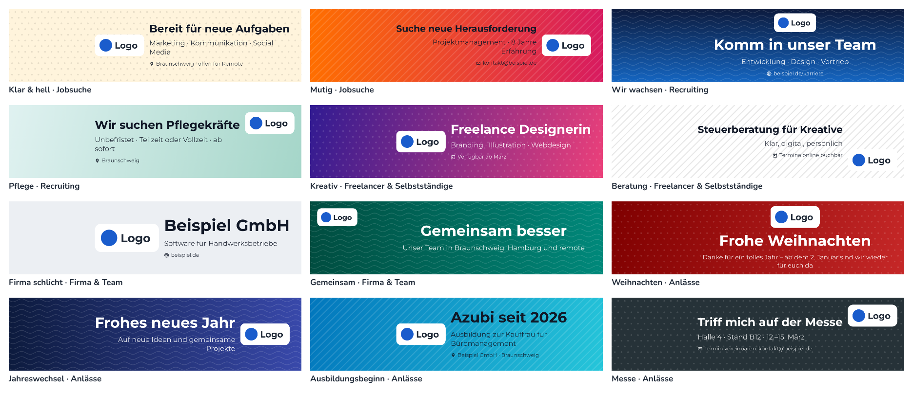

# RingLabel – Profilbild-Rahmen mit eigenem Text

Eine einzige, komplett kostenlose Web-Seite für runde Profilbild-Rahmen: eigener Text, eigenes Logo, eigene Farben und Schriften. Ohne Anmeldung, ohne Backend, ohne Hinweis im Bild.

**Grundprinzip:** Fotos und Logos werden ausschließlich im Browser verarbeitet und **nie** hochgeladen. Keine Cookies, keine Statistik, keine Anfragen an fremde Server.

Live: <https://lassehueb.github.io/ringlabel/>

## Funktionen

| Bereich | Was es gibt |
|---|---|
| **Editor** | Foto laden (JPG, PNG, WebP, HEIC), Zuschnitt per Ziehen/Zoomen, gebogener Text, alle Schriften, Farben und Farbverläufe, Symbole und Emojis im Ring, Ringbreite/-länge/-drehung, Live-Vorschau |
| **Mehrere Fotos** | Abschnitt `#mehrere-fotos` (einklappbar): aktuelles Design auf bis zu 30 Fotos anwenden, eigener Text pro Foto, Ausschnitt einzeln anpassen, alle als ZIP (1080 oder 2048 px) – nur im Browser |
| **Profil-Banner** | Abschnitt `#banner` unter dem Editor: breites Banner (4:1, 3:1, 16:9) im Design des Rahmens oder mit eigener Hintergrundfarbe (auch Verlauf, Weiß, Hellgrau, transparent), eigenem Logo, drei Textzeilen, Muster oder Hintergrundbild und 12 Banner-Vorlagen; markierter Bereich für das Profilbild; PNG in voller Größe |
| **Formen** | „Bogen“ (Standard), „Voller Ring“ (geschlossen rund um das Foto) und „Badge“ (abgerundetes Schild unten, Text gerade); bei Bogen und vollem Ring optional ein zweiter „Text oben“ |
| **Anlässe** | 8 Vorlagen für Feiertage und besondere Momente (Weihnachten, Jahreswechsel, Ostern, Ausbildungsbeginn, Ausbildung geschafft, Messe & Events, Neues Jahr im Job, Sommerpause); im passenden Zeitfenster oben unter „Gerade passend“ |
| **Vorlagen** | 34 mitgelieferte Vorlagen, dazu Ideen für Jobsuche, Recruiting, Selbstständige und Firmen mit „Vorlage übernehmen“ |
| **Logo** | PNG, JPG, WebP oder SVG, auf höchstens 512 px verkleinert; links vom Text, rechts vom Text oder statt Text; Größe einstellbar |
| **Design als Link** | „Link zu diesem Design kopieren“ im Vorlagen-Bereich und bei jeder eigenen Vorlage; wer den Link öffnet, hat sofort denselben Rahmen im Editor (ohne Foto und Logo) |
| **Eigene Vorlagen** | „Als eigene Vorlage speichern“ (alle Design-Einstellungen und Logo, nie das Foto) im lokalen Speicher des Browsers; umbenennen, löschen, als JSON-Datei exportieren und importieren (streng geprüft, höchstens 1 MB) |
| **Export** | PNG in 1080 × 1080 oder 2048 × 2048 px, Hintergrund transparent oder weiß, auf dem Handy direkt teilen |
| **Teilen** | „Link kopieren“ und die Teilen-Funktion des Geräts – geteilt wird nur die Startseite |
| **Sprachen** | Deutsch unter `/`, Englisch unter `/en/`; Umschalter „DE \| EN“ im Header, keine automatische Weiterleitung |
| **Recht** | Impressum und Datenschutzerklärung (Angaben in `config/site.json` → `legal`, nur auf Deutsch), Unabhängigkeitshinweis im Footer |

Frühere Adressen (`/rahmen/…`, `/vorlage/…`, `/premium/`, `/unternehmen/`, `/admin/`, `/team/`) leiten über die `404.html` auf die Startseite weiter; `/rahmen/<name>/` und `/vorlage/<name>/` öffnen dabei die gleichnamige Vorlage. Unbekannte Pfade unter `/en/` landen auf `/en/`.

## Mehrere Fotos

Zwischen Editor und Profil-Banner (Sprungmarke `#mehrere-fotos`, öffnet den eingeklappten Bereich) lässt sich das aktuelle Rahmen-Design auf bis zu 30 Fotos gleichzeitig anwenden. Code: `public/js/batch.js`, ZIP-Schreiber: `public/js/zip.js`, Markup: `src/partials/batch.html` (die Leiste „Ausschnitt anpassen“ steht in `src/partials/editor.html`).

- **Fotos:** JPG, PNG, WebP oder HEIC wie beim Einzelfoto (gleicher Lade-Code über `PBG.editor.decodeFile`), auswählen oder hineinziehen; mehr als 30 und Nicht-Bilder werden mit Hinweis abgelehnt.
- **Design:** Form, Text, Text oben, Logo, Farben und Hintergrund kommen aus dem Editor; ändert sich etwas, werden alle Vorschauen gedrosselt neu gezeichnet (nur bei echter Design-Änderung, wenige pro Frame).
- **Eigener Text pro Foto** (höchstens 60 Zeichen, z. B. ein Name); leer = Haupttext (steht als Platzhalter im Feld). Bei Logo „Statt Text“ ist das Feld ausgeblendet.
- **Ausschnitt:** automatisch zentriert. „Ausschnitt anpassen“ lädt das Foto in den normalen Editor (mit seinem eigenen Text in der Vorschau); „Übernehmen“ speichert den neuen Ausschnitt, „Abbrechen“ lässt ihn unverändert. Das vorher geladene Einzelfoto samt Ausschnitt kommt in beiden Fällen zurück.
- **ZIP:** „Alle als ZIP herunterladen“ rendert nacheinander in 1080 oder 2048 px (Hintergrund wie unter „6. Export“), mit Fortschritt („3 von 10“, für Screenreader angesagt) und Abbrechen. Datei `ringlabel-rahmen.zip` (Englisch `ringlabel-frames.zip`); Bilder `<Originalname>-rahmen.png` (`-frame.png`), Namen in Unicode-NFC, unzulässige Zeichen (`\ / : * ? " < > |`, Steuerzeichen) durch `-` ersetzt, Dubletten ohne Rücksicht auf Groß-/Kleinschreibung durchnummeriert (`team-rahmen.png`, `team-rahmen-2.png`).
- **ZIP-Format:** selbst geschrieben, Methode „stored“ (unkomprimiert, PNGs sind schon komprimiert), CRC32, Dateinamen UTF-8 mit Flag-Bit 11; kein ZIP64 (bis 4 GB / 65 535 Dateien).
- **Speicher:** Fotos werden beim Laden einzeln dekodiert, auf höchstens 2048 px verkleinert und komprimiert als Blob gehalten (JPEG, PNG-Dateien als PNG), dazu nur eine 320-px-Vorschauquelle; Canvas werden nach dem Rendern auf Größe 0 gesetzt. Gemessen (Chromium, 30 Fotos à 4000 × 3000 px): gehaltene Fotodaten 16 MB; der Seitenprozess belegt nach Speicherbereinigung rund 60 MB mehr als ohne Fotos.
- **Datenschutz:** Die Fotos werden nie gespeichert – nicht im lokalen Speicher, nicht in eigenen Vorlagen, nicht in Design-Links – und beim Schließen oder Neuladen der Seite verworfen.

## Profil-Banner

Unter dem Rahmen-Editor (Sprungmarke `#banner`, keine eigene Unterseite) entsteht ein breites Banner – standardmäßig im Design des aktuellen Rahmens, auf Wunsch unabhängig davon. Code: `public/js/banner.js`, Markup: `src/partials/banner.html`, Formate, Standardwerte, Prüfung und Banner-Vorlagen: `public/js/presets.js`.

| Format | Größe |
|---|---|
| Breit 4:1 | 1584 × 396 px |
| Breit 3:1 | 1500 × 500 px |
| 16:9 | 1920 × 1080 px |

- **Texte:** Überschrift (höchstens 60 Zeichen, eine Zeile), Unterzeile (100 Zeichen, bis zu zwei Zeilen), Zusatzzeile (80 Zeichen, z. B. Website, Kontakt oder Ort) mit optionalem Symbol aus der Symbol-Auswahl (u. a. Weltkugel, Brief, Ortsmarke). Je Zeile ein Regler für die Schriftgröße (50–150 %). Zu lange Texte werden verkleinert bzw. gekürzt, mit Hinweis. Schrift, Schriftstärke der Überschrift und Textfarbe kommen standardmäßig aus dem Rahmen („Wie im Rahmen“ / automatisch), lassen sich aber im Banner eigens wählen; eine leere Überschrift zeigt den Text des Rahmens.
- **Hintergrundfarbe:** „Wie der Rahmen“ (Standard), „Eigene Farbe“ (optional Verlauf mit zweiter Farbe, waagerecht, senkrecht oder diagonal), „Weiß“, „Hellgrau“ oder „Transparent“ (PNG mit Alphakanal, in der Vorschau als Schachbrett; Hinweis, dass viele Plattformen transparente Flächen füllen). Darüber optional ein dezentes Muster (Punkte, Linien, Wellen – die Musterfarbe passt sich dem Hintergrund an) oder ein eigenes Bild (nur im Browser, Zoom und Verschieben, Farbschleier in der gewählten Hintergrundfarbe).
- **Lesbare Textfarbe:** Hebt sich die Textfarbe des Rahmens nicht genug von der Hintergrundfarbe ab (Kontrast unter 3:1), nimmt das Banner Weiß oder fast Schwarz. Bei „Transparent“ bleibt die Farbe; ist sie auf Weiß oder Schwarz schlecht lesbar, erscheint ein Hinweis.
- **Logo im Banner:** „Wie im Rahmen“ (Standard), „Eigenes Logo“ (PNG, JPG, WebP, SVG; im Browser auf höchstens 1024 px verkleinert) oder „Kein Logo“. Position: automatisch (wie bisher: neben dem Text bzw. darüber), links oder rechts vom Text, über dem Text oder in einer Ecke (oben links, oben rechts, unten rechts – unten links liegt das Profilbild). Regler für die Logogröße.
- **Bereich, den das Profilbild verdecken kann:** links unten, je Format in `PBG.BANNER_FORMATS[…].safe`. In der Vorschau schraffiert, nie im Download. Text und Logo weichen ihm aus (bei „links“ und „rechts“ immer, bei „mittig“, sobald eine Logo-Position gewählt ist; das Logo oben links bleibt oberhalb des Bereichs).
- **Banner-Vorlagen:** 12 Vorlagen in den Gruppen Jobsuche, Recruiting, Freelancer & Selbstständige, Firma & Team und Anlässe (`PBG.BANNER_PRESETS`). Eine Vorlage ändert nur das Banner (Format und Logo-Art bleiben); mit „Farben vom Rahmen übernehmen“ nimmt sie statt ihrer eigenen Farben die des Rahmens. Anlass-Banner (Weihnachten, Jahreswechsel, Ausbildungsbeginn, Messe) nutzen über `occasionOf` die Zeitfenster der Anlass-Rahmen und erscheinen dann unter „Gerade passend“. Umgekehrt ändert eine Rahmen-Vorlage das Banner nicht: Hat das Banner einen eigenen Hintergrund, übernimmt es vor dem Wechsel Schrift, Schriftstärke, Textfarbe und Überschrift fest (`PBG.banner.detachFromFrame`, mit Hinweis; zurückstellbar auf „Wie im Rahmen“). Bei „Wie der Rahmen“ folgt das Banner weiter dem Rahmen. Dasselbe gilt für eigene Vorlagen und Design-Links ohne Banner-Einstellungen.
- **Neue Banner-Vorlage:** Eintrag in `PBG.BANNER_PRESETS` mit `key`, `group`, `name`, `title`, `subtitle`, optional `extra` (je `{ de, en }`, `{year}` möglich), `values` (Schlüssel aus `PBG.BANNER_DEFAULTS`) und optional `occasionOf`. `npm run check` prüft Texte auf Netzwerk-Begriffe und Anlass-Verweise; `npm run images` aktualisiert die Übersicht `public/img/beispiele/banner-vorlagen.png`.
- **Speichern:** „Als eigene Vorlage speichern“ und der Datei-Export speichern Rahmen und Banner zusammen: das Objekt `banner` mit allen Einstellungen (`PBG.BANNER_DEFAULTS`) und, falls vorhanden, `bannerLogo` (eigenes Banner-Logo als PNG, höchstens 512 px). Ein Hintergrundbild wird nie gespeichert. Ältere Vorlagen und Dateien bleiben gültig; fehlende Banner-Schlüssel bekommen Standardwerte, die genau das frühere Banner ergeben. Beim Import werden ungültige Werte verworfen und gemeldet.
- **Design-Link:** enthält zusätzlich `banner` mit den vom Standard abweichenden Einstellungen (nie Logo, Banner-Logo oder Bild). Links ohne `banner` lassen das Banner unverändert.



## Anlässe und „Gerade passend“


Vorlagen mit einem Zeitfenster (`occasion` in `public/js/presets.js`) stehen im Editor in der Gruppe „Anlässe“. Liegt das heutige Datum des Geräts im Zeitfenster, erscheinen sie stattdessen oben im Vorlagen-Bereich unter „Gerade passend“. Das passiert nur im Browser; es wird nichts übertragen.

| Anlass | Schlüssel | Zeitfenster |
|---|---|---|
| Weihnachten | `weihnachten` | 1.12.–26.12. |
| Jahreswechsel | `jahreswechsel` | 27.12.–10.1. |
| Ostern | `ostern` | 14 Tage vor Ostersonntag bis Ostermontag (jedes Jahr neu berechnet) |
| Ausbildungsbeginn | `azubi-start` | 1.8.–30.9. |
| Ausbildung geschafft | `ausbildung-geschafft` | 15.1.–28.2. und 1.6.–31.7. (Prüfungszeiten) |
| Messe & Events | `messe` | 15.2.–30.4. und 1.9.–15.11. (Messesaison) |
| Neues Jahr im Job | `neues-jahr-ziele` | 2.1.–31.1. |
| Sommerpause | `sommerpause` | 1.7.–31.8. |

**Neuen Anlass hinzufügen:**

1. In `public/js/presets.js` im Abschnitt „Anlässe“ einen Eintrag ergänzen:
   ```js
   { key: "schulstart", name: { de: "Schulstart", en: "Back to school" }, text: { de: "Schulstart {year}", en: "Back to school {year}" },
     occasion: ["08-15/09-15"],
     values: { shape: "badge", ringColor: "#2e7d32", textColor: "#ffffff", font: "Poppins", uppercase: false, icon: "star", iconPos: "start" } },
   ```
   - `occasion`: ein oder mehrere Zeitfenster `"MM-TT/MM-TT"` (jeweils einschließlich; `"12-27/01-10"` läuft über den Jahreswechsel) oder relativ zu Ostern, z. B. `"easter-14/easter+1"`.
   - `{year}` im Text wird durch das aktuelle Jahr ersetzt; `textTop` (Text oben) ist optional.
   - Texte kurz halten: Sie sollen auf den Ring bzw. das Badge passen, ohne verkleinert zu werden.
2. Bei Bedarf ein Symbol in `public/js/icons.js` ergänzen (24 × 24-Pfad, selbst gezeichnet, `stroke: true` für Linien).
3. `npm run build && npm run check` – die Prüfung meldet ungültige Zeitfenster und eine Gestaltung, die an Netzwerk-Rahmen erinnert (grüner oder lila Bogen unten/links mit heller Hashtag-Schrift in Großbuchstaben).
4. `npm run images` aktualisiert die Übersicht `public/img/beispiele/anlaesse.png`.

**Testen mit anderem Datum:** Nur auf `localhost` bzw. `127.0.0.1` lässt sich ein Datum simulieren, z. B. `http://localhost:8080/?datum=2026-12-24`. Auf der veröffentlichten Seite wird der Parameter ignoriert und immer das Datum des Geräts verwendet.

## Formen und Text oben

| Bogen mit Text oben | Voller Ring | Badge |
|---|---|---|
|  |  |  |

- **Bogen** (`shape: "arc"`, Standard): wie bisher. Ein Text oben bekommt einen eigenen kurzen Bogen in Ringfarbe (bei Verlauf mit gespiegelten Farben) mit denselben weichen Enden (höchstens 30°).
- **Voller Ring** (`shape: "ring"`): geschlossener Ring ohne weiche Enden; Ringlänge und weicher Übergang sind ausgeblendet. Ein Verlauf läuft von unten (Ringfarbe) nach oben (zweite Farbe). Die Drehung dreht Texte und Verlauf.
- **Badge** (`shape: "badge"`): abgerundetes Schild unten mittig über dem Foto, Text gerade, Farbe und Deckkraft wie der Ring. Die Ringbreite heißt hier „Höhe des Badges“; Text oben, Position auf dem Bogen, Ringlänge, Drehung und weicher Übergang sind ausgeblendet. Das Logo sitzt links oder rechts im Schild oder allein darin.
- **Text oben** (`textTop`, höchstens 40 Zeichen, `sizeTop` = eigene Schriftgröße in % der Ringbreite, Standard 60): läuft oben gebogen und ist von außen lesbar. Schrift, Farbe, Großbuchstaben und Buchstabenabstand wie beim Haupttext; Symbole, Emojis und Logo gehören zum Haupttext. Höchstens 150° lang; längere Texte werden wie der Haupttext verkleinert, mit Hinweis.
- **Kompatibilität:** `shape`, `textTop` und `sizeTop` stehen in `PBG.DESIGN_KEYS` und werden in eigenen Vorlagen, im Datei-Export/-Import und im Design-Link gespeichert und beim Import streng geprüft. Ihre Standardwerte (`"arc"`, `""`, `60`) ergeben das bisherige Aussehen – ältere Vorlagen, Dateien und Links sehen unverändert aus (geprüft: 144 Designs pixelgleich mit dem vorigen Stand). Das Link-Format bleibt deshalb Version 1.
- **Beispielbilder:** `npm run images` erzeugt neben OG-Bildern und Icons auch `public/img/beispiele/*.png` (für dieses README).

## Design als Link

Ein Design lässt sich als Link weitergeben, z. B. `https://ringlabel.de/#d=eyJ2IjoxLCJ0ZXh0Ijoi…` (auf `/en/` entsprechend `/en/#d=…`).

- **Format:** `#d=` + Base64url (ohne `=`) von kompaktem JSON `{"v":1,"text":…,"font":…, …, "banner":{…}}` mit allen Schlüsseln aus `PBG.DESIGN_KEYS` und optional `banner` (nur vom Standard abweichende Banner-Einstellungen). Foto, Hintergrundbild, Logo und Banner-Logo sind nie enthalten; ist ein Logo gesetzt, weist der Dialog darauf hin. Typische Links mit Banner bleiben unter 2000 Zeichen.
- **Version:** `v` ist die Formatversion (`LINK_VERSION` in `public/js/app.js`). Ändert sich das Format, bekommt es eine neue Nummer und `parseDesignLink` liest ältere Versionen weiter. Links mit unbekannter Version werden mit einer Meldung abgelehnt.
- **Prüfung beim Öffnen:** dieselbe wie beim Datei-Import (`validValue`): nur bekannte Schlüssel, Zahlen im Bereich der Regler, Farben nur als `#rrggbb`, Text höchstens 60 Zeichen, nur vorhandene Schriften und Symbole. Ungültiges wird verworfen und in einer Meldung genannt; ist gar nichts gültig, zu lang (über 4000 Zeichen nach `d=`) oder kaputt, erscheint die Standardvorlage mit einem Hinweis. Die Grenze liegt bei 4000, weil ein gültiges Design mit vollen Textfeldern aus 3-Byte-Zeichen (Rahmen + Banner) rund 3200 Zeichen erreichen kann.
- **Datenschutz:** Der Teil nach `#` wird vom Browser nicht an den Server geschickt. Nach dem Laden entfernt `history.replaceState` das Fragment aus der Adresse, damit es nicht versehentlich weitergeteilt wird. Ein Link, der in einen schon offenen Tab eingefügt wird (nur das Fragment ändert sich), wird ebenfalls geladen.
- **Vorrang:** `#d=…` gilt vor `?vorlage=…`; ohne Fragment funktioniert `?vorlage=<name>` wie bisher.

## Sprachversionen

| Sprache | Adresse | `lang` | OG-Bild |
|---|---|---|---|
| Deutsch (Standard, `x-default`) | `/` | `de` | `img/og/home.jpg` |
| Englisch | `/en/` | `en` | `img/og/home-en.jpg` |

Beide Startseiten verweisen per `hreflang` aufeinander (plus `x-default` → Deutsch), haben je einen eigenen Canonical und stehen mit ihren Alternativen in der Sitemap. Impressum und Datenschutzerklärung gibt es nur auf Deutsch; der englische Footer verlinkt sie als „Legal notice (in German)“ und „Privacy policy (in German)“.

**Wo die Texte stehen:**

- `src/content.mjs` → `locales.de` / `locales.en`: Title, Description, H1, Einleitung, Text-Ideen, FAQ, strukturierte Daten (`app`), Texte im OG-Bild (`ogImage`) sowie Header, Footer, Hinweise und Unabhängigkeitshinweis (`ui`)
- `public/js/i18n.js` → `PBG.I18N.de` / `PBG.I18N.en`: alle Editor-Texte. Der Build übersetzt das Editor-Markup (`src/partials/editor.html`) damit schon vorab und bricht ab, wenn auf `/en/` ein Schlüssel fehlt. Im Browser richtet sich die Sprache nach `<html lang>`.
- `public/js/presets.js` und `public/js/icons.js`: Vorlagen-Namen und -Texte, Schrift- und Symbolnamen als `{ de, en }`. Englische Vorlagen-Texte kurz halten – sie dürfen auf dem Ring nicht verkleinert werden müssen.

**Weitere Sprache hinzufügen:** In `src/content.mjs` einen Eintrag in `locales` mit denselben Schlüsseln wie `de` ergänzen (`path: "/<code>/"`, `og: "/img/og/home-<code>.jpg"`), ein Wörterbuch `PBG.I18N.<code>` in `i18n.js` und die Fassungen in `presets.js`/`icons.js` ergänzen, dann `node scripts/render-images.mjs <code>` ausführen. Umschalter, `hreflang`, Sitemap und 404-Weiterleitung übernehmen die neue Sprache automatisch.

## Projektstruktur

```
config/site.json          Name, Adresse, Angaben für Impressum/Datenschutz
public/                   Statische Dateien, werden 1:1 ausgeliefert
  js/renderer.js          Canvas-Rendering (Foto, Ring, gebogener Text, Symbole, Logo)
  js/app.js               Editor-Logik, Logo, eigene Vorlagen, Teilen-Dialog
  js/banner.js            Profil-Banner (Renderer, Bedienung, Download)
  js/batch.js             Mehrere Fotos (Liste, Vorschauen, Ausschnitt, ZIP-Export)
  js/zip.js               ZIP-Schreiber („stored“, CRC32, UTF-8-Dateinamen)
  js/platform.js          Konfiguration, lokaler Speicher, Farbschema
  js/presets.js           Schriften, Standardwerte, Vorlagen
  js/icons.js             Symbole und Emojis für den Ring
  js/i18n.js              Editor-Texte (Deutsch + Englisch)
  img/ fonts/ vendor/     OG-Bilder und Icons, lokale Schriften (OFL), heic2any
src/
  content.mjs             Texte der Startseiten je Sprache (Title, Einleitung, Ideen, FAQ, Header/Footer)
  layout.mjs              Seitenlayout, Meta-Tags, strukturierte Daten, Unabhängigkeitshinweis
  partials/editor.html    Editor-Markup
  partials/banner.html    Markup des Profil-Banners
  partials/batch.html     Markup von „Mehrere Fotos“
  pages/core.mjs          Startseiten (/ und /en/)
  pages/legal.mjs         Impressum und Datenschutzerklärung
scripts/
  build.mjs               Statischer Build nach dist/ (ohne Abhängigkeiten)
  check-dist.mjs          Prüfung des Builds (siehe unten)
  serve.mjs               Lokaler Webserver
  render-images.mjs       Erzeugt OG-Bilder und Icons mit dem echten Renderer
```

## Lokal starten

Voraussetzung: [Node.js](https://nodejs.org) ab Version 20. Weitere Pakete werden nicht benötigt.

```bash
npm run dev          # baut nach dist/ und startet http://localhost:8080
npm run build        # nur bauen
npm run check        # dist/ prüfen
```

OG-Bilder und Icons neu erzeugen (Playwright nur vorübergehend, keine Projekt-Abhängigkeit):

```bash
npm i --no-save playwright && npx playwright install chromium
npm run images                        # alle Sprachen und Icons
node scripts/render-images.mjs en     # nur das englische OG-Bild (dist/ muss gebaut sein)
```

## Prüfung

`npm run check` (läuft auch im Deploy-Workflow) schlägt fehl bei:

- toten internen Links oder Ressourcen und URLs ohne `BASE_PATH`
- den Begriffen „Premium“, „PRO“, „Stripe“ oder „Erstellt mit“
- Namen oder Rahmen-Begriffen sozialer Netzwerke, in allen Sprachversionen – einzige Ausnahme ist das Element `<p class="independence-note">` (Unabhängigkeitshinweis, `independenceNote` in `src/layout.mjs`); es darf nur Text enthalten
- Platzhaltern oder `[eckigen Klammern]` in Impressum und Datenschutz
- Skripten, Styles, Schriften oder Bildern von fremden Servern
- dem alten Namen

## Veröffentlichung über GitHub Pages

Der Workflow `.github/workflows/pages.yml` baut bei jedem Push auf `main`, prüft das Ergebnis und veröffentlicht `dist/`.

1. *Settings → Pages → Source: GitHub Actions*
2. Ohne weitere Einstellungen läuft die Seite unter `https://<name>.github.io/<repo>/`; der Unterordner wird automatisch als `BASE_PATH` gesetzt.
3. Eigene Domain: Variable `SITE_URL` (z. B. `https://www.deine-domain.de`) unter *Settings → Secrets and variables → Actions → Variables* setzen und die Domain unter *Settings → Pages → Custom domain* eintragen.

Unter `/<repo>/` liegt die `robots.txt` nicht im Domain-Stamm und wird von Suchmaschinen ignoriert; die Sitemap bei Bedarf direkt in der Search Console einreichen.

## Archiv: Bezahl- und Firmen-Version

Premium (Einmalkauf über Stripe), Firmen-Pakete mit Admin-Bereich und Team-Links sowie das Supabase-Backend sind aus diesem Stand entfernt. Der vollständige Code liegt unverändert auf dem Branch [`archiv/premium`](https://github.com/LasseHueb/ringlabel/tree/archiv/premium).
